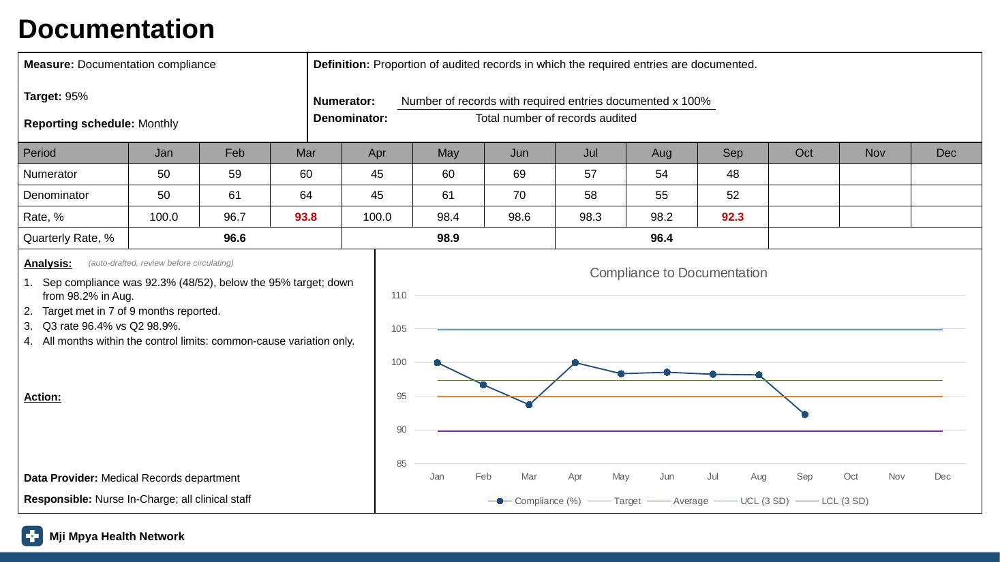
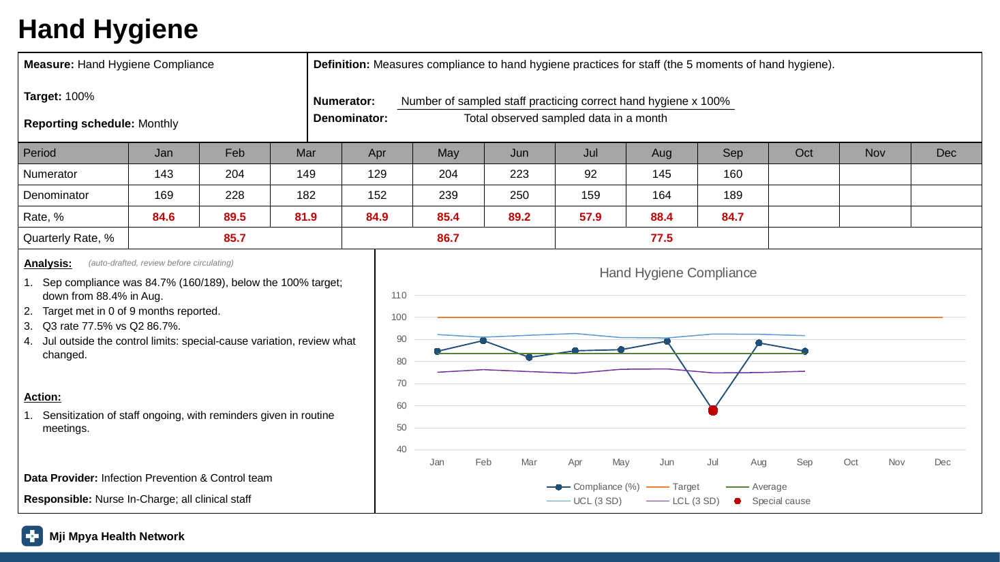
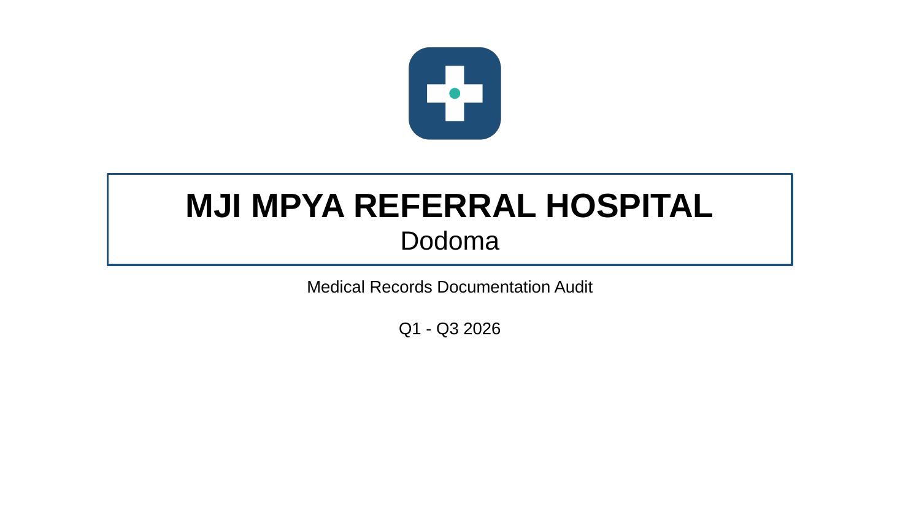
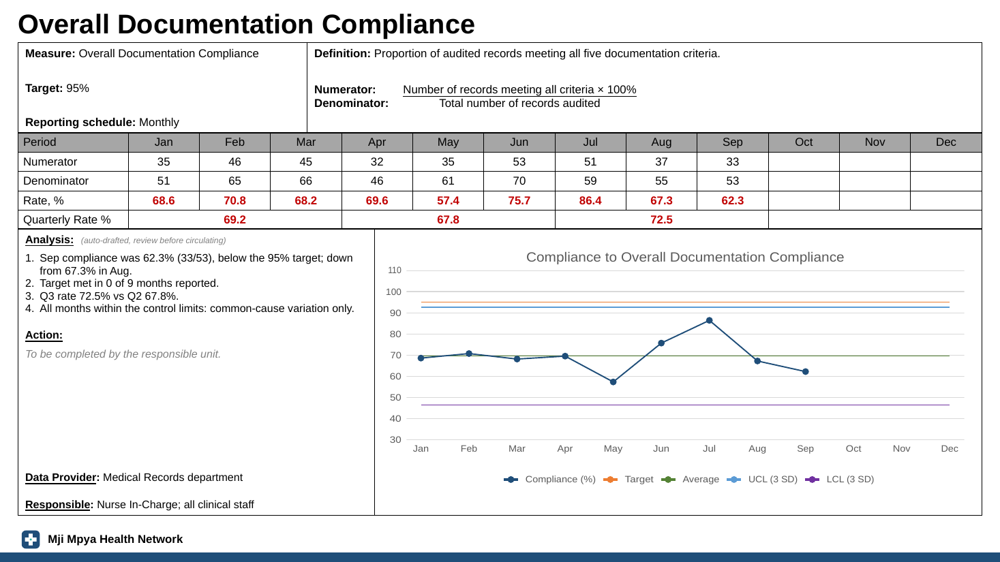

# KPI Deck

**Excel in, finished KPI slides out.** An R tool that turns any audit spreadsheet or table of monthly totals into a branded PowerPoint deck (and optionally a PDF) with one slide per indicator: a monthly table, quarterly rates, a control chart and auto-drafted analysis.

I built it in my work as a Quality and Patient Safety physician. Every month, departments sent their audit results to be turned into KPI slides by hand, with the same table, chart and analysis box every time. Now it's one function call per dataset. This repository runs on **synthetic data** for a fictional hospital.



## What a deck contains

1. A **title slide** with the facility, deck title, unit and reporting period (worked out from the data, e.g. "Q1 - Q3 2026").
2. An **indicator list**.
3. **One slide per indicator:**
   - measure, target, reporting schedule, definition, and numerator over denominator
   - a 12-month table with numerators, denominators, rates and pooled quarterly rates (below-target values in red)
   - a **native PowerPoint control chart**, so anyone can right-click it and choose *Edit Data*
   - **auto-drafted analysis**: last month against target and the month before, months meeting target, quarter-on-quarter change, and special-cause signals
   - an action box for the team, plus the data provider and who is responsible

Control limits can be **mean ± 3 SD** of monthly rates (matching the Excel sheet it replaced), a **p-chart**, or a **Laney p′ chart** for very large denominators. In this example the p-chart flags a July drop in hand hygiene as special-cause variation:



## Use it

```r
source("R/kpi_functions.R")

make_indicator_sheet("audits/hand_hygiene_2026.xlsx")   # first time only: finds the Yes/No
                                                        # columns and writes an indicator sheet
                                                        # for you to fill in Excel

make_kpi_deck("audits/hand_hygiene_2026.xlsx",          # every month
              title = "Hand Hygiene Audit")
#> Created audits/output/Hand_Hygiene_Audit_2026.pptx
```

It accepts two kinds of input and detects which one it has:

| Input | Looks like | How indicators are computed |
|---|---|---|
| **Raw records** | one row per audited record: a date, then Yes/No/N/A columns | `column`: Yes ÷ (Yes + No) for one criterion. `all`: record passes only if every criterion is Yes. `pooled`: all answers pooled. N/A is left out of the denominator. |
| **Monthly totals** | `indicator`, `month`, `numerator`, `denominator` | summed by month |

The code and the content are kept apart. Titles, definitions, targets, analysis and actions live in an **indicator sheet** in Excel, so non-programmers can maintain them, and a blank analysis cell gets an auto-drafted one.

## Useful options

| Option | Default | |
|---|---|---|
| `group_col` | none | e.g. `"unit"` gives one deck per ward or unit |
| `limits_method` | `"sd"` | `"p"` or `"laney"` |
| `quarter_method` | `"pooled"` | total numerator ÷ total denominator, or `"mean"` of monthly rates |
| `output` | `"pptx"` | `"pdf"` or `c("pptx", "pdf")` (PDF uses [Typst](https://typst.app)) |
| `facility`, `footer`, `period`, `year` | | title-slide and footer text |

## Make it yours

- **Branding** lives in `templates/kpi_master.pptx` (View → Slide Master). Restyle or move anything, but keep the `ph_…` placeholder names and the layout names `Brand Title`, `Indicator List` and `KPI Indicator`.
- **PDF look** lives in `templates/kpi-deck.typ`. R writes the numbers to JSON and Typst lays out the slides.
- Logos are in `assets/`.

## Try it

```r
install.packages(c("readxl", "dplyr", "tidyr", "purrr", "officer", "flextable",
                   "mschart", "xml2", "writexl", "ggplot2", "jsonlite", "svglite"))
source("run.R")                       # raw records  -> data/output/
source("examples/run_aggregate.R")    # monthly totals -> examples/output/
```

Sample outputs are in [`samples/`](samples/): a full deck, a per-unit deck, a monthly-totals deck and a PDF.

| PowerPoint title slide | PDF version (Typst) |
|---|---|
|  |  |

## Design notes

- **Quarterly rates are pooled** (total numerator ÷ total denominator), so a month with 20 audits doesn't weigh the same as one with 200. Each quarter is shown only once all three of its months have data.
- **N/A is not "No".** Unanswered or not-applicable criteria leave the denominator instead of counting as failures.
- **PowerPoint stays editable.** Tables are real tables and charts are real charts, not pictures, so a department can fix a typo or restyle without coming back to R.
- **Text fits its box.** Long definitions and analysis lists shrink their font to fit their placeholders instead of overflowing.

## License

MIT. See [LICENSE](LICENSE).
